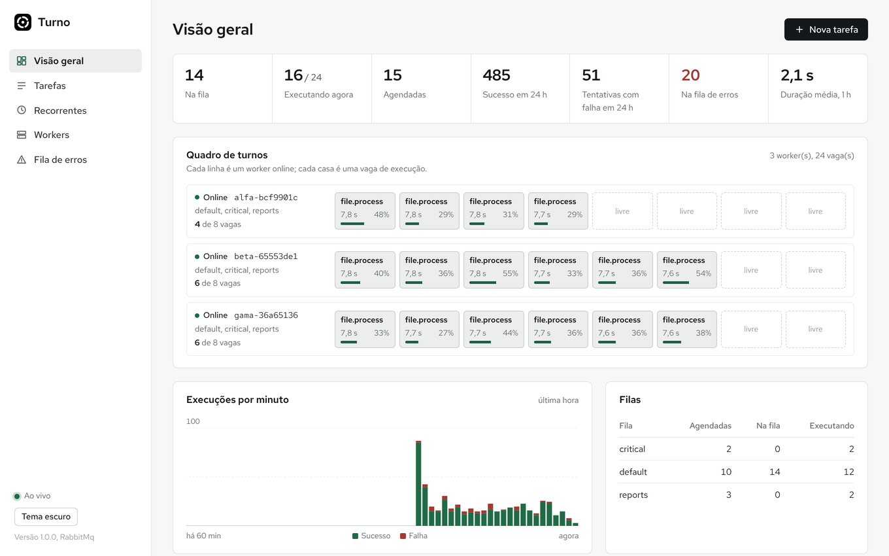
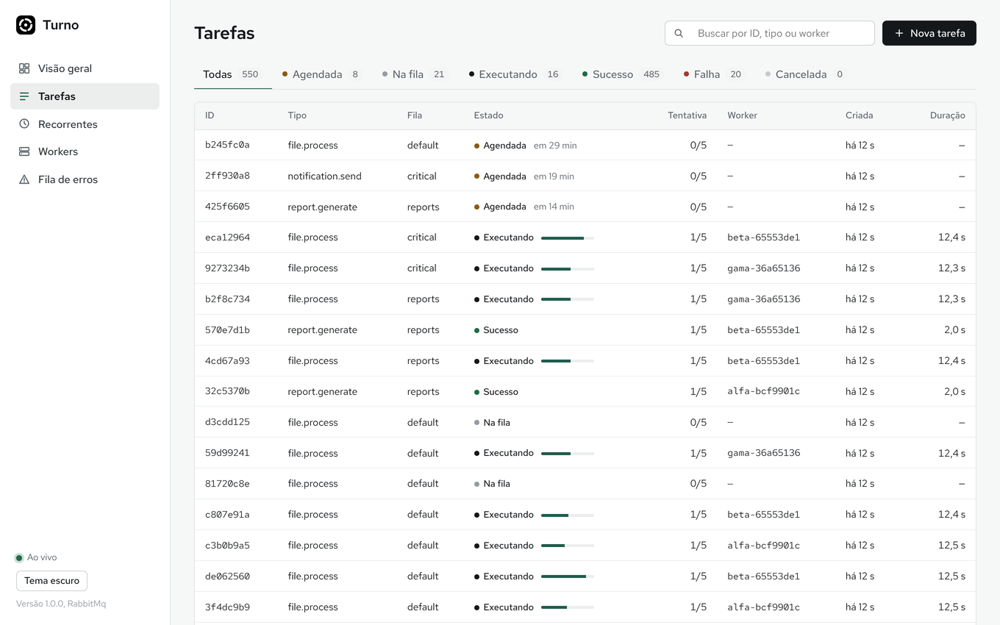
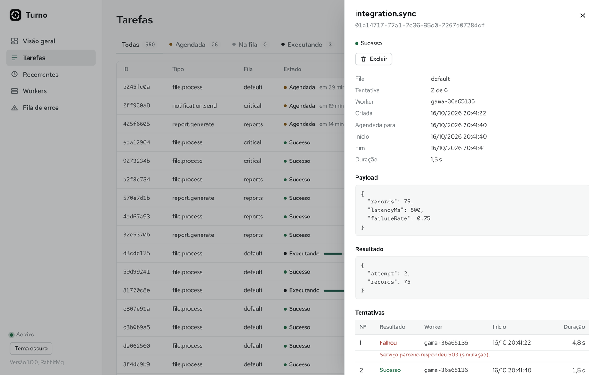
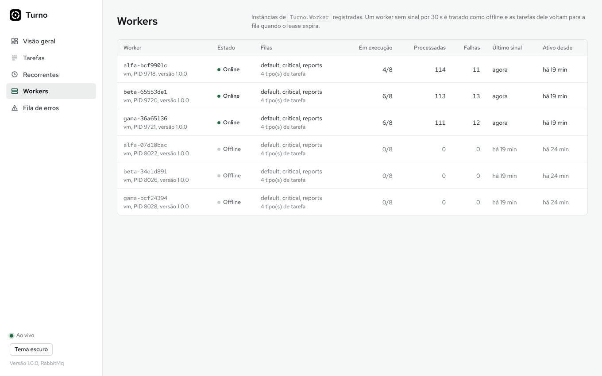
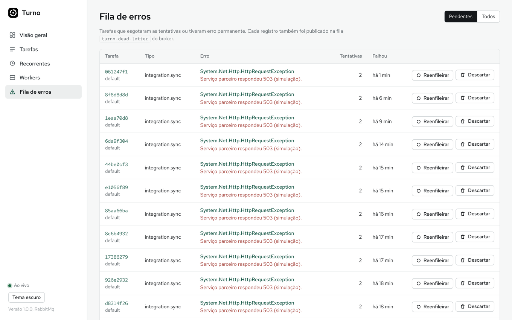
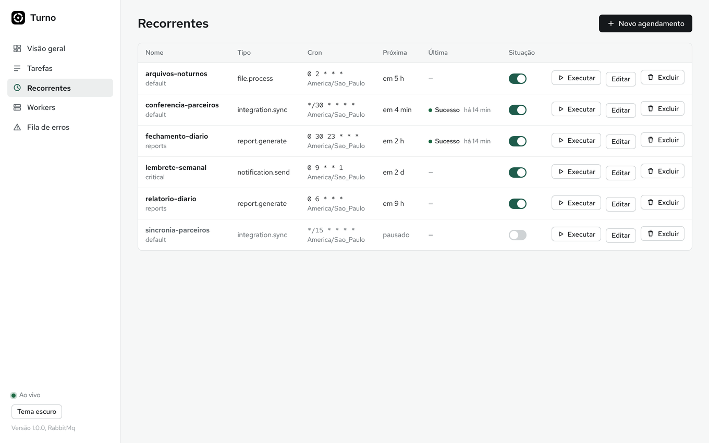
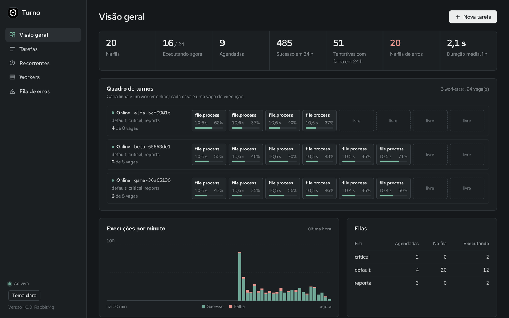
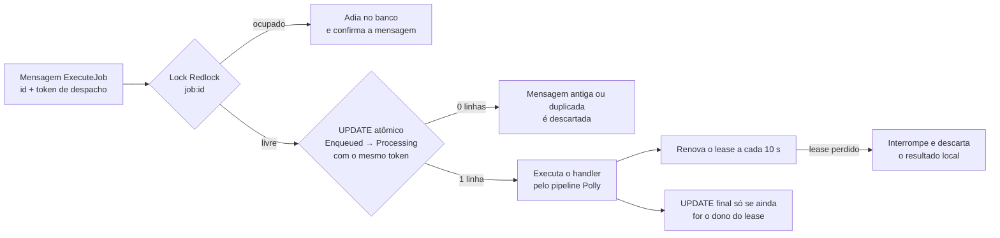
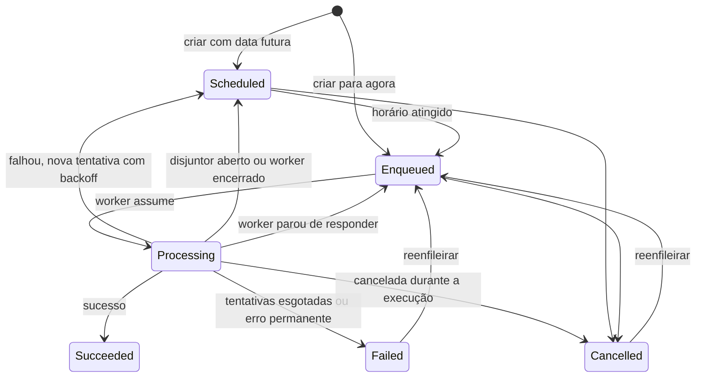
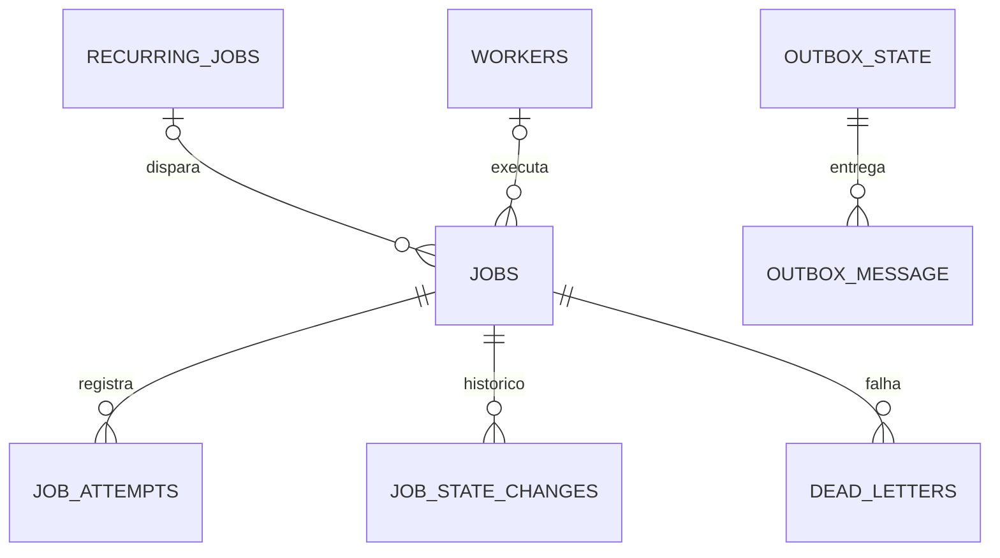

<p align="center">
  
</p>

<h1 align="center">Turno<br><sub><sup><sup><sub>Copyright (©) 2026 Erik Pimenta</sub></sup></sup></sub></h1>

<p align="center">
  Motor de agendamento e processamento de tarefas distribuídas, no estilo Hangfire, em que vários workers idênticos dividem a mesma fila.<br>
  Cada tarefa roda uma única vez por tentativa, mesmo com mensagens duplicadas, workers que caem no meio do processo e reinícios do broker.
</p>

<p align="center">
  C# · .NET 10 · Worker Services · MassTransit · RabbitMQ ou Azure Service Bus · Redis (Redlock) · Polly · PostgreSQL · EF Core · Blazor WebAssembly · SignalR · Docker
</p>

---

> **Manual completo:** [`Manual-Turno.pdf`](Manual-Turno.pdf) explica as ferramentas usadas, instalação, configuração, cada tela do painel, a API, como escrever seus próprios handlers, resiliência, escala horizontal e solução de problemas, passo a passo (cópia em [`docs/`](docs/Manual-Turno.pdf)).

> **Banco de dados:** [`Banco-de-Dados-Turno.pdf`](Banco-de-Dados-Turno.pdf) traz o diagrama de relacionamentos que o banco deve seguir, todas as tabelas com campos, tipos e chaves, e as regras de cada uma.

<p align="center">
  
</p>

## O que o Turno faz

- **Fila distribuída de verdade:** quantos workers você quiser, clonados, consumindo as mesmas filas do RabbitMQ (ou Azure Service Bus) pela biblioteca MassTransit.
- **Uma execução por vez, garantida em duas camadas:** lock distribuído Redlock no Redis antes de começar e uma troca atômica de estado no PostgreSQL (token de despacho + lease), que funciona como token de cerca caso o Redis falhe.
- **Recuperação de workers que caem:** cada execução tem um lease renovado a cada 10 s. Se o worker some, a tarefa volta para a fila sozinha e a tentativa fica registrada como "worker perdido".
- **Resiliência com Polly:** nova tentativa imediata para falhas passageiras, disjuntor (circuit breaker) por tipo de tarefa, tempo limite por tarefa e novas tentativas com backoff exponencial e jitter.
- **Fila de erros (dead-letter):** quando as tentativas acabam, a tarefa vai para a tabela `dead_letters` e para a fila `turno-dead-letter` do broker, com erro e stack trace. Dá para reenfileirar pelo painel ou pela API.
- **Agendamento:** execução imediata, com atraso, em data e hora marcadas ou recorrente por expressão cron (com segundos e fuso horário).
- **Chave de concorrência:** tarefas com a mesma chave (por exemplo, `cliente-42`) nunca rodam ao mesmo tempo, em nenhum worker.
- **Idempotência:** o cabeçalho `Idempotency-Key` evita tarefas duplicadas quando o cliente repete a requisição.
- **Cancelamento cooperativo** de tarefas em execução, progresso em porcentagem e resultado gravado em JSON.
- **Encerramento gracioso:** ao desligar um worker, as tarefas em andamento têm tempo para terminar; as que não terminam voltam para a fila sem contar como tentativa.
- **Painel em Blazor WebAssembly** com atualização em tempo real por SignalR, tema claro e escuro e layout para celular.

## Interface

Painel de operação, pensado para ser lido de relance:

- O **quadro de turnos** mostra cada worker online como uma linha e cada vaga de execução como uma casa. Casas ocupadas trazem o tipo da tarefa, o tempo decorrido e a barra de progresso.
- Indicadores numa faixa única: na fila, executando agora (sobre a capacidade total), agendadas, sucessos e falhas em 24 h, fila de erros e duração média.
- Execuções por minuto da última hora em barras empilhadas, sucesso e falha.
- Fundo cinza bem claro, superfícies brancas e bordas finas. Um único tom de destaque, o verde-pinho `#1F5C4C`, aparece na navegação, nas barras de progresso, na seleção e no foco do teclado.
- As cores de estado aparecem só nos marcadores; o texto continua em tinta neutra para não cansar.
- A marca é sempre em preto e branco.
- Tema escuro com os mesmos tons, ajustados para fundo escuro, e escolha guardada no navegador.
- Fonte [Red Hat Text](https://github.com/RedHatOfficial/RedHatFont), com Red Hat Mono para IDs, cron e JSON, ambas incluídas no projeto (sem CDN).

| Cor | Uso |
|---|---|
| `#F6F7F7` | Fundo das páginas |
| `#FFFFFF` | Painéis, tabelas e formulários |
| `#E2E5E6` | Bordas e divisórias |
| `#5F666B` | Textos de apoio |
| `#15181B` | Texto e botões principais |
| `#1F5C4C` | Destaque, progresso e foco |

| Estado | Cor |
|---|---|
| Executando | `#15181B` |
| Sucesso | `#1F6B45` |
| Falha | `#A03A32` |
| Agendada | `#8A5A12` |
| Na fila | `#959B9F` |
| Cancelada | `#C6CACC` |

| Tela | |
|---|---|
|  |  |
|  |  |
|  |  |

## Como o Turno evita execução dupla



1. **Token de despacho:** toda vez que uma tarefa entra na fila, ela recebe um `dispatch_id` novo, que vai na mensagem. Só a mensagem com o token atual consegue iniciar a tarefa; reenvios, duplicatas e mensagens antigas são ignorados.
2. **Redlock:** o worker pega o lock `job:{id}` no Redis (com renovação automática) antes de tocar no banco. Com várias instâncias de Redis configuradas, o lock exige quórum, como no algoritmo Redlock original.
3. **Troca atômica de estado:** a passagem para `Processing` é um único `UPDATE ... WHERE state = 'Enqueued' AND dispatch_id = @token`. Duas instâncias nunca conseguem o mesmo resultado.
4. **Lease com cerca:** o término só é gravado se o worker ainda for o dono (`worker_id`, `dispatch_id` e `state` iguais). Um worker que travou e voltou depois não sobrescreve o trabalho de quem assumiu.
5. **Outbox transacional:** a mensagem para o broker é gravada na mesma transação da tarefa (outbox do MassTransit com EF Core). Se o banco aceitou, a mensagem sai; se o banco recusou, nada é publicado.

### Ciclo da tarefa



## Resiliência

| Camada | Ferramenta | Comportamento padrão |
|---|---|---|
| Nova tentativa imediata | Polly `Retry` | 2 novas tentativas com backoff exponencial a partir de 500 ms, só para erros passageiros |
| Disjuntor | Polly `CircuitBreaker` | Abre quando 50% das execuções de um tipo falham em 30 s (mínimo de 10). Fica aberto por 30 s e as tarefas são adiadas sem contar tentativa |
| Tempo limite | Polly `Timeout` | 10 min por padrão, ajustável por tipo ou por tarefa |
| Novas tentativas da tarefa | Agendador do Turno | Até 5 tentativas, com espera de 15 s, 30 s, 60 s… até 15 min, com 20% de jitter |
| Fila de erros | Tabela `dead_letters` + fila `turno-dead-letter` | Recebe a tarefa quando as tentativas acabam ou quando o handler lança `PermanentJobException` |
| Mensagens envenenadas | MassTransit `_error` | Mensagens que não conseguem nem ser processadas (banco fora do ar por muito tempo, por exemplo) vão para a fila `_error` do próprio MassTransit |

Tudo é configurável em `Turno:Resilience`, inclusive por tipo de tarefa em `Turno:Resilience:Types`.

## Como rodar

Pré-requisito: **Docker** (Docker Desktop no Windows e no macOS).

**Windows:** dê dois cliques em `iniciar.cmd`.
**Linux / macOS:** `./iniciar.sh`

O script cria o `.env` a partir do `.env.example`, gera senhas aleatórias para PostgreSQL, Redis e RabbitMQ e uma chave de acesso para a API, sobe tudo com Docker e abre o navegador em **http://localhost:8080**. A chave aparece no terminal e fica só no seu `.env`.

O ambiente sobe com:

| Serviço | Endereço | Função |
|---|---|---|
| `api` | http://localhost:8080 | API REST, painel e hub SignalR |
| `worker` × 3 | sem porta | Workers que consomem as filas |
| `postgres` | 127.0.0.1:5432 | Estado das tarefas e outbox |
| `redis` | 127.0.0.1:6379 | Locks distribuídos |
| `rabbitmq` | http://localhost:15672 | Broker e painel do RabbitMQ |

Para gerar carga de demonstração com os handlers de exemplo:

```bash
./scripts/demo.sh 60
```

No Windows: `powershell -File scripts\demo.ps1 -Count 60`.

### Sem Docker para as aplicações

Pré-requisito: **.NET SDK 10**. Suba só a infraestrutura e rode API e workers pelo `dotnet`:

```bash
docker compose up -d postgres redis rabbitmq
```

Configure as conexões com `dotnet user-secrets` (nada fica no repositório) em `src/Turno.Api` e em `src/Turno.Worker`:

```bash
dotnet user-secrets set "ConnectionStrings:Turno" "Host=localhost;Database=turno;Username=turno;Password=<senha>"
dotnet user-secrets set "Turno:Messaging:RabbitMq:Username" "turno"
dotnet user-secrets set "Turno:Messaging:RabbitMq:Password" "<senha>"
dotnet user-secrets set "Turno:Redis:Connections:0" "localhost:6379,password=<senha>"
```

Depois, em terminais separados:

```bash
dotnet run --project src/Turno.Api
dotnet run --project src/Turno.Worker
dotnet run --project src/Turno.Worker
```

Cada `dotnet run` do worker é mais uma instância no cluster.

## Escalando os workers

```bash
docker compose up -d --scale worker=8
```

Os workers não têm estado próprio: qualquer um pode morrer, reiniciar ou ser adicionado a qualquer momento. O que muda entre eles é só a configuração de filas e concorrência:

```json
"Turno": {
  "Worker": {
    "Queues": [
      { "Name": "default", "Concurrency": 4 },
      { "Name": "critical", "Concurrency": 2 },
      { "Name": "reports", "Concurrency": 2 }
    ]
  }
}
```

Tarefas de agendamento, recuperação e limpeza rodam em um líder por vez, eleito a cada ciclo pelo Redlock, então dá para ligar quantos workers quiser sem duplicar essas rotinas.

## Criando seus próprios handlers

Um handler é uma classe com o atributo `[JobType]`. O payload chega tipado, o token de cancelamento respeita tempo limite, cancelamento e encerramento, e o progresso aparece no painel:

```csharp
using Turno.Core.Handlers;

namespace MinhaEmpresa.Tarefas;

public sealed record GerarBoletosPayload(int Lote, string Competencia);

[JobType("boletos.gerar")]
public sealed class GerarBoletosHandler(IBoletoService boletos) : JobHandler<GerarBoletosPayload>
{
    protected override async Task ExecuteAsync(GerarBoletosPayload payload, JobContext context, CancellationToken cancellationToken)
    {
        if (payload.Lote <= 0)
        {
            throw new PermanentJobException("O lote precisa ser maior que zero.");
        }

        var total = await boletos.ContarAsync(payload.Lote, cancellationToken);
        for (var i = 0; i < total; i++)
        {
            await boletos.GerarAsync(payload.Lote, i, cancellationToken);
            await context.ReportProgressAsync((i + 1) * 100 / total, cancellationToken);
        }

        context.SetResult(new { total });
    }
}
```

Registre o assembly no `Program.cs` do worker:

```csharp
builder.Services.AddJobHandlersFromAssembly(typeof(GerarBoletosHandler).Assembly);
```

E enfileire pela API:

```bash
curl -X POST http://localhost:8080/api/jobs \
  -H "Content-Type: application/json" \
  -H "X-Turno-Key: <sua chave>" \
  -H "Idempotency-Key: boletos-2026-10-lote-7" \
  -d '{"type":"boletos.gerar","queue":"default","payload":{"lote":7,"competencia":"2026-10"}}'
```

Os quatro handlers de exemplo (`report.generate`, `file.process`, `integration.sync` e `notification.send`) ficam em [`samples/Turno.Samples`](samples/Turno.Samples) e podem ser desligados com `Turno:Samples:Enabled=false`.

## Configuração

As opções ficam em `appsettings.json` e podem ser sobrescritas por variáveis de ambiente (`Turno__Worker__Queues__0__Concurrency=8`). O [`.env.example`](.env.example) lista as variáveis do Docker; o `.env` nunca vai para o Git.

| Seção | Principais opções | Padrão |
|---|---|---|
| `ConnectionStrings:Turno` | Conexão com o PostgreSQL | obrigatória |
| `Turno:Messaging` | `Transport` (`RabbitMq` ou `AzureServiceBus`), `QueuePrefix`, credenciais | `RabbitMq`, `turno` |
| `Turno:Redis` | `Connections` (uma para dev, 3 ou 5 independentes para Redlock com quórum), `KeyPrefix` | `localhost:6379` |
| `Turno:Worker` | `Queues`, `LeaseDuration`, `LeaseRenewalInterval`, `LockExpiry`, `HeartbeatInterval`, `ShutdownTimeout` | 60 s, 10 s, 30 s, 5 s, 30 s |
| `Turno:Scheduler` | `Interval`, `BatchSize` | 2 s, 200 |
| `Turno:Recovery` | `Interval`, `LeaseGracePeriod`, `RedispatchEnqueuedAfter` | 10 s, 15 s, desligado |
| `Turno:Retention` | Tempo de guarda de tarefas concluídas, canceladas, com falha e de workers offline | 7 d, 7 d, 30 d, 1 d |
| `Turno:Resilience` | Novas tentativas, backoff, tempo limite, disjuntor e ajustes por tipo | veja [Resiliência](#resiliência) |
| `Turno:Api` | `ApiKey`, `AllowedOrigins`, `EnableApiReference` | sem chave, sem CORS, docs ligadas |
| `Turno:RecurringJobs` | Agendamentos recorrentes declarados no appsettings | 2 exemplos |

Para usar o **Azure Service Bus** no lugar do RabbitMQ:

```bash
Turno__Messaging__Transport=AzureServiceBus
Turno__Messaging__AzureServiceBus__ConnectionString=<connection string do namespace>
```

## API

Documentação interativa em **http://localhost:8080/docs** (Scalar) e especificação OpenAPI em `/openapi/v1.json`. Com `Turno:Api:ApiKey` definido, todas as rotas (menos `/api/info` e `/health`) exigem o cabeçalho `X-Turno-Key`.

| Método | Rota | Função |
|---|---|---|
| POST | `/api/jobs` | Enfileira ou agenda uma tarefa (`Idempotency-Key` opcional) |
| POST | `/api/jobs/batch` | Enfileira até 1000 tarefas |
| GET | `/api/jobs?state=&type=&queue=&search=&page=` | Lista com filtros e paginação |
| GET | `/api/jobs/{id}` | Detalhes, tentativas e linha do tempo |
| POST | `/api/jobs/{id}/cancel` · `/requeue` | Cancela ou devolve à fila |
| DELETE | `/api/jobs/{id}` | Exclui uma tarefa finalizada |
| GET | `/api/stats` · `/api/workers` · `/api/job-types` | Indicadores, workers e tipos conhecidos |
| GET · PUT | `/api/recurring-jobs` | Lista e cria ou atualiza agendamentos pelo nome |
| POST | `/api/recurring-jobs/{id}/trigger` · `/enable` · `/disable` | Dispara agora, ativa ou pausa |
| DELETE | `/api/recurring-jobs/{id}` | Exclui o agendamento |
| GET | `/api/dead-letters?pending=true` | Fila de erros |
| POST · DELETE | `/api/dead-letters/{id}/requeue` · `/api/dead-letters/{id}` | Reenfileira ou descarta |
| GET | `/health/live` · `/health/ready` | Sondas de vida e prontidão (PostgreSQL, Redis e broker) |
| WS | `/hubs/jobs` | Hub SignalR com `JobsChanged` e `WorkersChanged` |

Erros seguem o padrão Problem Details (RFC 9457):

```json
{ "title": "Dados inválidos para a tarefa.", "status": 400, "errors": { "type": ["Informe o tipo da tarefa com letras minúsculas, números, ponto, hífen ou sublinhado (até 200 caracteres)."] } }
```

## Banco de dados

PostgreSQL com EF Core e migrações versionadas, tudo no schema `turno`. A API aplica as migrações na subida, protegida por `pg_advisory_lock` para que duas instâncias nunca migrem ao mesmo tempo.



| Tabela | O que guarda |
|---|---|
| `jobs` | Cada tarefa: tipo, fila, payload JSONB, estado, tentativas, token de despacho, lease, progresso e resultado |
| `job_attempts` | Cada execução, com worker, resultado, duração e erro |
| `job_state_changes` | Linha do tempo de mudanças de estado com o motivo |
| `recurring_jobs` | Agendamentos cron, com fuso, próxima execução e controle de sobreposição |
| `workers` | Instâncias registradas, filas, concorrência e último sinal de vida |
| `dead_letters` | Tarefas que esgotaram as tentativas, com stack trace |
| `outbox_message` · `outbox_state` · `inbox_state` | Outbox transacional do MassTransit |

O diagrama completo, com todos os campos, tipos, chaves, índices e restrições, está em [`Banco-de-Dados-Turno.pdf`](Banco-de-Dados-Turno.pdf).

## Estrutura

```
src/
  Turno.Contracts/       mensagens do broker, DTOs da API e serialização compartilhada
  Turno.Core/            domínio, máquina de estados, cron, backoff, handlers e opções
  Turno.Infrastructure/  EF Core e migrações, MassTransit, Redlock, Polly e repositórios
  Turno.Worker/          Worker Service: consumidor, lease, heartbeat, agendador, recuperação e limpeza
  Turno.Api/             API REST, hub SignalR, chave de acesso e hospedagem do painel
  Turno.Dashboard/       painel em Blazor WebAssembly
samples/
  Turno.Samples/         handlers de exemplo
tests/
  Turno.Tests/           testes de unidade
  Turno.IntegrationTests/ cluster com vários workers contra PostgreSQL, Redis e RabbitMQ reais
scripts/                 inicialização no Windows e carga de demonstração
docs/                    imagens, manual e diagrama do banco
```

## Testes

```bash
dotnet test tests/Turno.Tests
```

Os testes distribuídos sobem vários workers no mesmo processo contra serviços reais e provam, entre outras coisas, que 60 tarefas em 3 workers rodam exatamente uma vez cada, que duplicatas e mensagens antigas são ignoradas, que um worker que trava tem a tarefa recuperada e o resultado descartado, que a chave de concorrência impede sobreposição e que o encerramento gracioso devolve a tarefa à fila:

```bash
docker compose up -d postgres redis rabbitmq
export TURNO_TEST_POSTGRES="Host=localhost;Username=turno;Password=<senha>;Database=postgres"
export TURNO_TEST_REDIS="localhost:6379,password=<senha>"
export TURNO_TEST_RABBITMQ="amqp://turno:<senha>@localhost:5672"
dotnet test tests/Turno.IntegrationTests
```

A integração contínua ([`.github/workflows/ci.yml`](.github/workflows/ci.yml)) compila tudo, roda as duas suítes com PostgreSQL, Redis e RabbitMQ como serviços e gera as imagens Docker.

## Segurança e privacidade

- O repositório não traz senhas, chaves nem endereços reais. O `.env` é gerado na sua máquina e está no `.gitignore`.
- Portas do Docker presas a `127.0.0.1`; só a API fica exposta, e na porta que você escolher.
- Chave de acesso opcional comparada em tempo constante; no painel ela fica só na memória da aba.
- Cabeçalhos de segurança (CSP, `X-Frame-Options`, `nosniff`, `Referrer-Policy`) em todas as respostas.
- Os handlers de exemplo usam apenas endereços reservados (`example.com`) e mascaram o destinatário no resultado.
- O painel não carrega nada de fora: fontes, ícones e scripts vêm do próprio servidor.
- A telemetria de uso do MassTransit vem desligada, então nenhum dado do seu ambiente é enviado para fora.

## Licença

[MIT](LICENSE). Use, copie, altere e distribua à vontade. As fontes Red Hat Text e Red Hat Mono são distribuídas sob a [SIL Open Font License](src/Turno.Dashboard/wwwroot/fonts/OFL-RedHat.txt).
